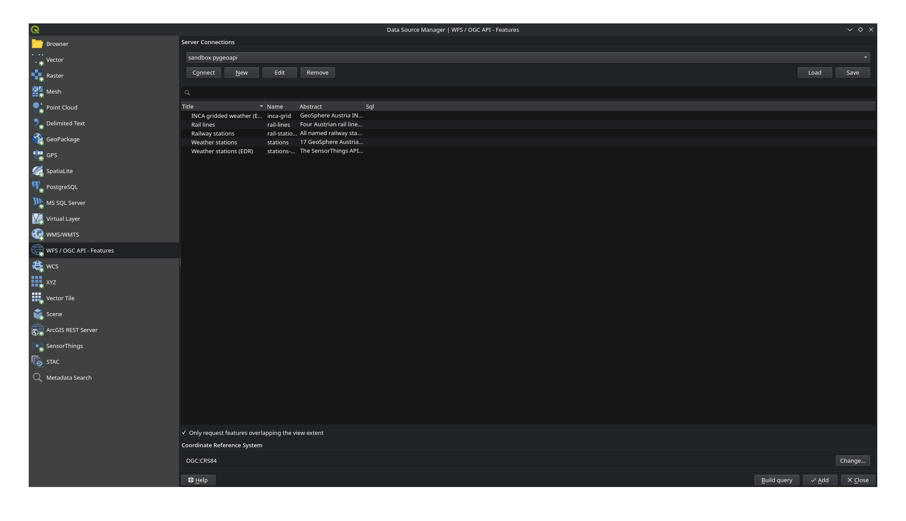
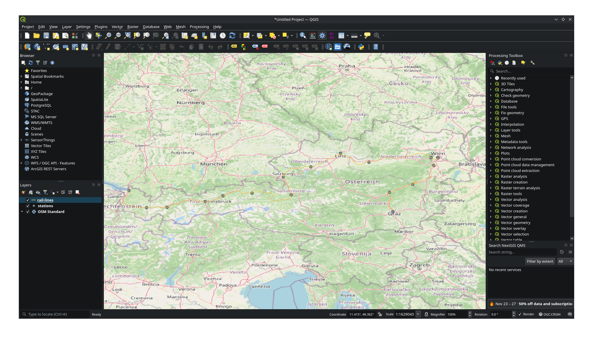
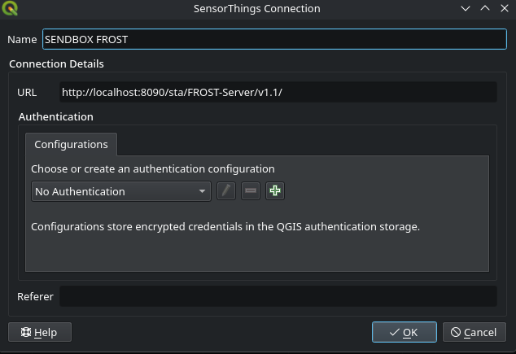
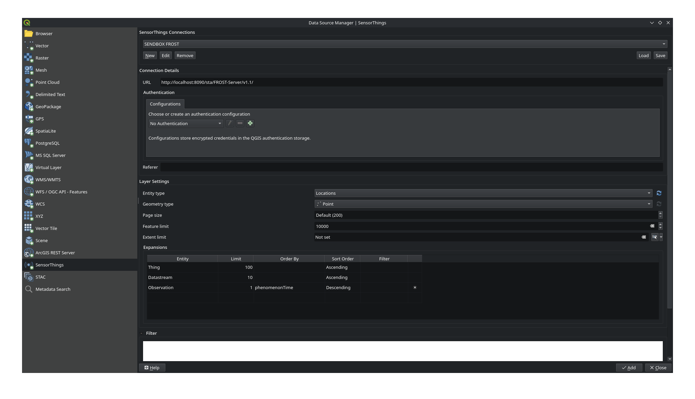
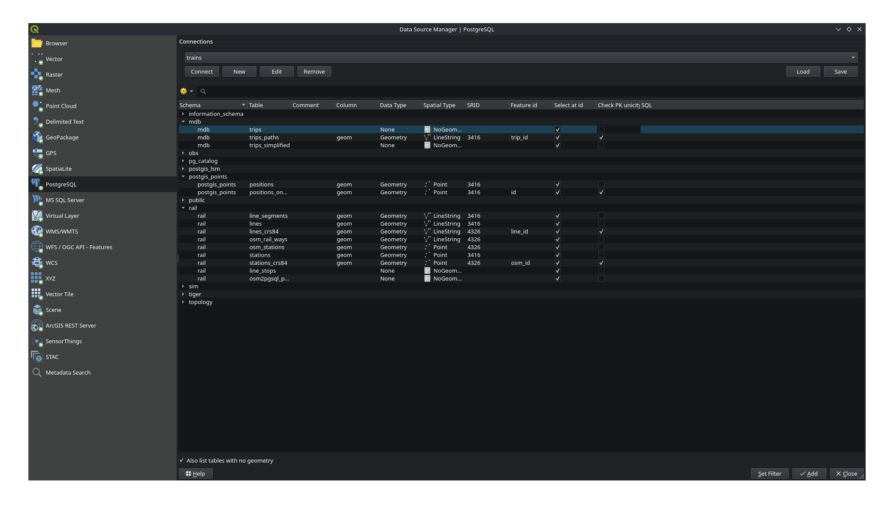
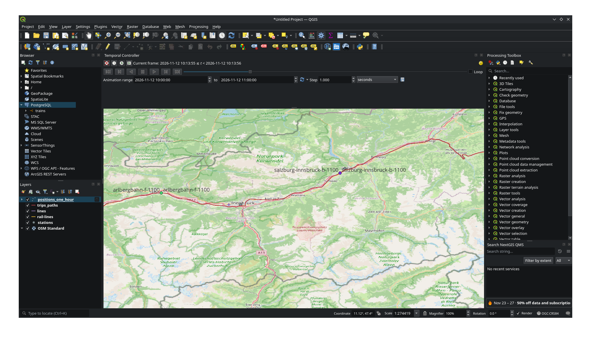
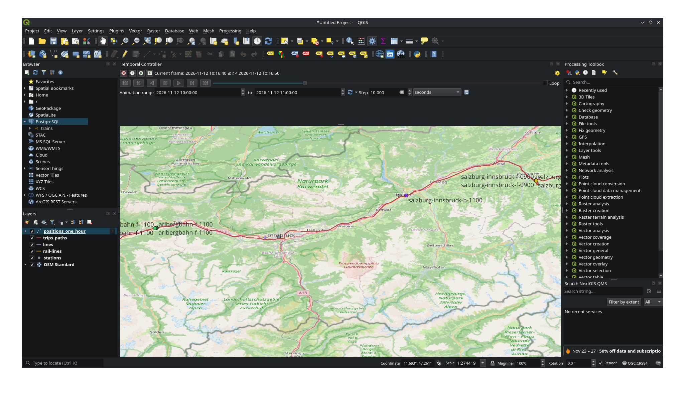
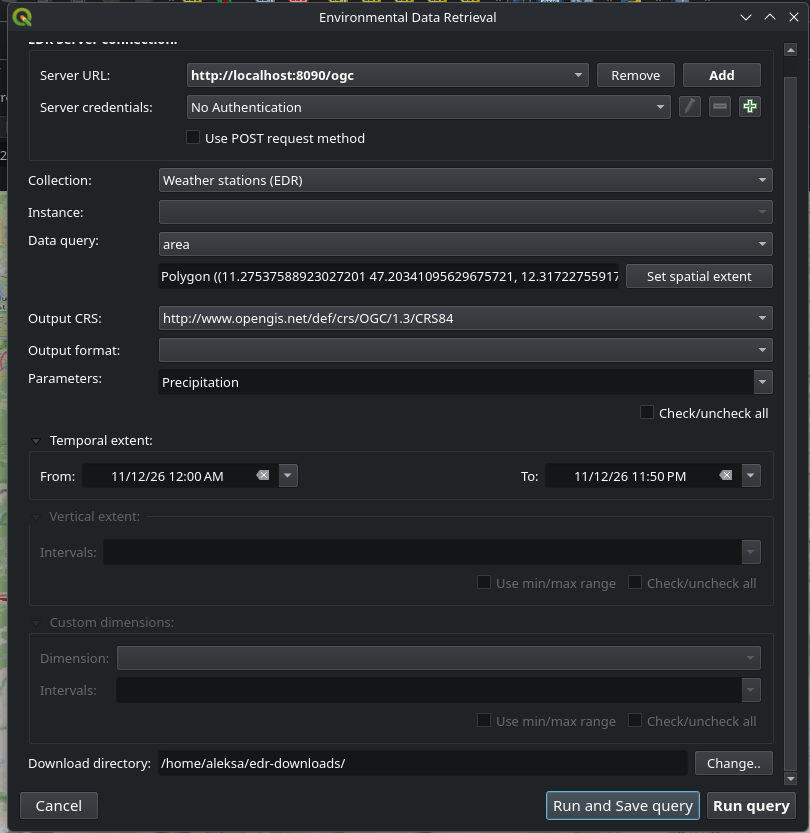
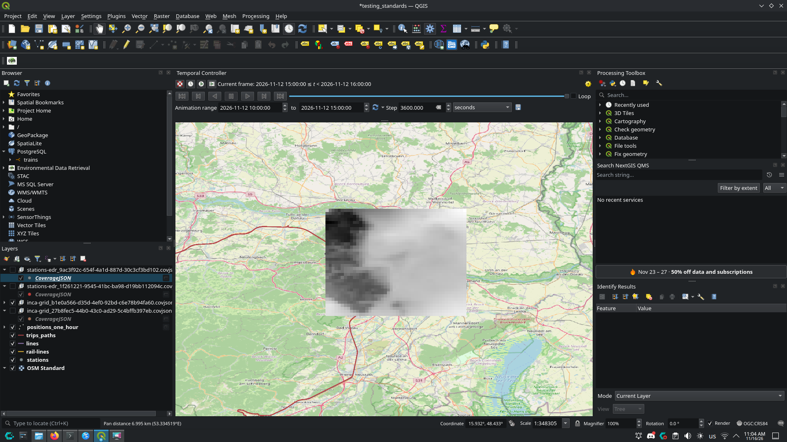
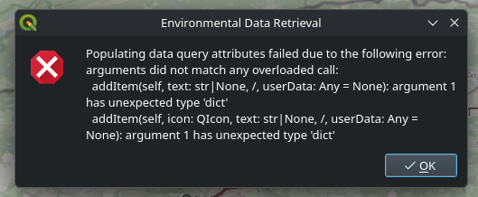

# QGIS uputstvo (provera interoperabilnosti)

Kako standardni desktop GIS čita iste podatke koje koristi web aplikacija. Testirano sa **QGIS 4.x**.
Servisi moraju biti pokrenuti (`scripts/stack.fish up`), a podaci učitani (`scripts/data.fish all`).

Nazivi menija odgovaraju QGIS 3.x/4.x i mogu se malo razlikovati između verzija; Data Source Manager (**Ctrl+L**) ima karticu za svaki izvor koji se ovde koristi.

| Deo | Standard / izvor | Podrška u QGIS-u |
|---|---|---|
| 1 | OGC API – Features (pygeoapi) | ugrađena |
| 2 | OGC SensorThings API (FROST) | ugrađena od verzije 3.36 |
| 3 | PostGIS / MobilityDB (vozovi) + Temporal Controller | ugrađena (PostGIS); MobilityDB tipove ne prepoznaje → pogledi (views) |
| 4 | OGC API – EDR (pygeoapi) | **nije u jezgru**; dodatak (plugin) treće strane |

---

## 1. Pruge i stanice preko OGC API – Features

1. **Ctrl+L** → kartica **WFS / OGC API – Features** → **New**.
2. Name: `sandbox pygeoapi`, URL: `http://localhost:8090/ogc`. Version: ostaviti *Maximum* ili izabrati
   *OGC API – Features*. **OK**.
3. **Connect**. Pojavljuju se tri kolekcije: `rail-lines`, `rail-stations`, `stations`.
4. Izabrati `rail-lines` i `stations` → **Add**.

Šta proveriti i zabeležiti:
- Pruge se prikazuju na pravom mestu (bez zamene redosleda osa; pygeoapi kroz poglede vraća CRS84).
- `stations` dolazi iz FROST-a preko pygeoapi-ja: istih 17 stanica kao u delu 2.
- Straničenje: `rail-stations` ima 1.521 objekat; QGIS treba da prati `next` linkove (podrazumevana
  veličina strane u pygeoapi-ju je 100).

## 2. Meteorološke stanice preko SensorThings API

1. **Ctrl+L** → kartica **SensorThings** → **New**.
2. Name: `sandbox FROST`, URL: `http://localhost:8090/sta/FROST-Server/v1.1`, autentifikacija: bez. **OK**.
3. Na ovoj kartici **nema dugmeta Connect**. Dva dugmeta sa kružnim strelicama pored **Entity type** i
   **Geometry type** šalju upit serveru; ako se obe liste popune bez greške, veza radi.
4. Entity type: **Locations**, geometry type: **Point**. Veličina strane (podrazumevano 200) i ograničenje
   broja objekata mogu ostati; QGIS prati FROST linkove za straničenje.
5. Opciono **Expansions** (prazna tabela dok se ne popuni, svaki red proširuje prethodni):
   - red 1: Entity **Things**
   - red 2: Entity **Datastreams**
   - red 3: Entity **Observations**, Limit `1`, Order By `phenomenonTime`, Sort Order opadajuće
   → poslednja vrednost svakog Datastream-a po stanici (kao trenutni prikaz u web aplikaciji).
6. Opciono **Filter** (polje na dnu), npr. `name eq 'Bregenz'`.
7. **Add**, pa otvoriti tabelu atributa.

Šta proveriti i zabeležiti:
- Da li dugmad za osvežavanje prikazuju tipove entiteta (Things, Locations, Datastreams, Observations, …)?
- Kako QGIS prikazuje proširene Things → Datastreams → Observations u tabeli atributa
  (jedan red po merenju, ugnežđena polja, JSON)?
- Da li polje za filter prihvata STA sintaksu (`name eq 'Bregenz'`) ili QGIS izraz?
- Da li postoji rad sa vremenom (Temporal Controller nad Observations)?

## 3. Vozovi iz PostGIS / MobilityDB, animirani pomoću Temporal Controller-a

1. **Ctrl+L** → kartica **PostgreSQL** → **New**.
   - Name: `sandbox trains`, Host: `localhost`, Port: `25432`, Database: `trains`
   - Autentifikacija: korisnik i lozinka iz `.env` (`MOBILITYDB_USER`, `MOBILITYDB_PASSWORD`).
   - Čekirati *Also list tables with no geometry* (nije obavezno, ali prikazuje MobilityDB tabele).
2. **Connect** i dodati:
   - `rail.lines`
   - `mdb.trips_paths` (pogled: putanja svake simulirane vožnje kao LineString, iz pojednostavljenih vožnji)
   - `postgis_points.positions_one_hour` (pogled: GPS tačke 12. novembra, 10:00–11:00 UTC, ~70.000 tačaka)
3. Zabeležiti šta QGIS radi sa samom tabelom `mdb.trips`: kolona `trip` je MobilityDB tip `tgeompoint`,
   koji QGIS ne poznaje (prikazuje se bez geometrije ili kao nepoznat tip).
4. **Prvo kopirati u lokalni fajl:** desni klik na `positions_one_hour` → **Export → Save Features As…** →
   GeoPackage, dodati ga na mapu i ukloniti PostGIS sloj. U suprotnom QGIS ponovo šalje upit PostGIS-u
   za svaki kadar i mapa između kadrova ostaje prazna (treperenje).
5. **Animacija:** svojstva GeoPackage sloja → **Temporal** → uključiti **Dynamic temporal control** →
   konfiguracija *Single field with date/time* → polje `t` → **isključiti *Accumulate features over
   time*** (ako ostane uključeno, sve prethodne tačke ostaju vidljive i iscrtavaju trag) → *Event
   duration* 1 sekunda. Zatim **View → Panels → Temporal Controller** → **Animated temporal navigation**
   (dugme sa satom i play znakom, *ne* režim *Movie* sa filmskom trakom, koji prikazuje *Total frames* i
   ignoriše vreme sloja) → opseg 2026-11-12 10:00 – 11:00 UTC, korak 10 sekundi → ikonica zupčanika:
   4 kadra u sekundi → **Play**. Svaki kadar tada prikazuje ~10 GPS tačaka po vozu unutar svog
   10-sekundnog prozora.
6. **Stil po vozu:** **Symbology → Categorized** → Value `train_id` → **Classify** (jedna boja po vozu;
   jedan voz ima više vožnji dnevno). `trip_id` radi na isti način, ali daje jednu klasu po vožnji.
   Sa mnogo klasa boje se teško razlikuju, pa je bolje dodati oznaku sa `train_id`
   (**Labels → Single labels → Value `train_id`**) i ostaviti tačke u jednoj boji.
7. Razlika u odnosu na web aplikaciju: QGIS prikazuje **zabeležene tačke** za svaki vremenski prozor i
   ne interpolira između njih. Web aplikacija interpolira MF `tgsequence` (MobilityDB trajektoriju) za
   bilo koji trenutak, pa se njeni vozovi kreću glatko.

Šta proveriti i zabeležiti:
- Temporal Controller nad celom tabelom `postgis_points.positions` (11,2 M redova) bi trebalo da bude
  veoma spor; pogled za jedan sat ga čini upotrebljivim. Probati jednom i celu tabelu i zabeležiti ponašanje.
- QGIS ne može direktno da animira MobilityDB trajektoriju; pogledi su zaobilazno rešenje. (Postoji
  dodatak treće strane za MobilityDB — „MOVE” — koji ovde nije testiran.)
- Vremenska zona: vremena su u UTC-u (`timestamptz`); proveriti da li ih QGIS prikazuje kao UTC.

## 4. EDR: stanice i INCA mreža

Jezgro QGIS-a **nema EDR klijent i ne može da otvori CoverageJSON**. Dodatak treće strane
**„Environmental Data Retrieval”** (`edr_plugin`, verzija 1.1.0, QGIS 3.99–4.99) testira se najviše
jedan sat. Dodatak bez izmena ne radi; ispravke su opisane u [`qgis-edr-plugin-fixes.md`](qgis-edr-plugin-fixes.md).

1. **Plugins → Manage and Install Plugins** → pretražiti *Environmental Data Retrieval* → **Install**.
2. Otvoriti dodatak (traka sa alatkama ili meni **Plugins**). U **EDR Server connection** upisati
   `http://localhost:8090/ogc` kao *Server URL* → **Add**; kredencijali *No Authentication*; *Use POST
   request method* ostaviti neoznačeno.
3. **Collection**: padajuća lista prikazuje sve pygeoapi kolekcije po nazivu, uključujući i obične
   Features kolekcije. Samo dve su EDR:
   - **INCA gridded weather (EDR)** (`inca-grid`): tipovi upita `position`, `cube`; parametri `T2M`, `RH2M`, `RR`
   - **Weather stations (EDR)** (`stations-edr`): tipovi upita `items`, `locations`, `cube`, `area`;
     parametri su STA ObservedProperty ID-jevi (`10` temperatura vazduha, `14` padavine; spisak na
     `http://localhost:8090/sta/FROST-Server/v1.1/ObservedProperties?$select=id,name`)

   *Weather stations*, *Rail lines* i *Railway stations* su Features kolekcije i za njih je *Data query*
   prazan. *Instance* ostaje prazno za obe EDR kolekcije (instance nisu podešene).
4. Popuniti ostatak dijaloga odozgo nadole:
   - **Data query**: izabrati tip upita (vidi 5 i 6).
   - **Set spatial extent**: kliknuti i nacrtati na mapi (tačku za `position`, pravougaonik za `cube`,
     poligon za `area`). Sivo polje tada prikazuje geometriju.
   - **Output CRS** / **Output format**: izabrati CRS84 i CoverageJSON ako su ponuđeni. Ako padajuće
     liste ostanu prazne, to je nalaz: pygeoapi ne dodaje `output_formats` ni `crs_details` u
     `data_queries` u metapodacima kolekcije. Zabeležiti da li *Run query* i dalje radi.
   - **Parameters**: označiti jedan (`T2M` ili `14`).
   - **Temporal extent**: podrazumevano je *sada*. Postaviti **From** 2026-11-12 00:00 i **To**
     2026-11-12 23:00 (UTC; podaci pokrivaju period od 2026-11-04 do 2026-11-13). Koristiti pravi
     interval, jer jedan trenutak u pygeoapi 0.24.0 vraća 204.
   - **Vertical extent** / **Custom dimensions**: ne koriste se, ostaju sivi.
   - **Download directory** (na dnu, skrolovati): **Change** → izabrati folder, npr. `~/edr-downloads`.
   - **Run query** (samo učitava sloj) ili **Run and Save query** (čuva i upit za kasnije).
5. **inca-grid**: *position* u tački u Beču (oko 16.37, 48.21), zatim *cube* sa malim pravougaonikom
   oko Beča (oko 16.2–16.5 E, 48.1–48.3 N), oba sa `T2M`.
6. **stations-edr**: *locations* (izabrati stanicu ako ih dodatak prikazuje) sa `14`, zatim *area* sa
   poligonom oko dela pruge.

Šta proveriti i zabeležiti:
- Koje tipove upita dodatak nudi i koji od naših rade (`position`, `cube`, `locations`, `area`).
- Kako prikazuje CoverageJSON: rasterski sloj, sloj tačaka, tabela, grafikon?
- Da li su ID-jevi parametara („10”, „14”) razumljivi u dodatku.
- **Nalaz:** pygeoapi 0.24.0 upisuje `parameter_names.*.observedProperty.label` kao jezički objekat
  (`{"en": "Air temperature 2 m above ground"}`, po CoverageJSON stilu). `edr_plugin` 1.1.0 ga direktno
  prosleđuje Qt padajućoj listi, koja očekuje string, pa se dijalog zaustavlja sa *Populating data query
  attributes failed*. Ovo važi i za `inca-grid` i za `stations-edr`.
  Sopstveni CoverageJSON čitač dodatka podržava jezičke objekte (`coveragejson/utils.py`), samo dijalog
  ne. **Zaobilazno rešenje korišćeno u ostatku testa:** lokalna ispravka od dve linije u
  `edr_plugin/gui/__init__.py` (posle `observed_property["label"]`): ako je oznaka rečnik, uzima se
  vrednost `en`. Originalni fajl je sačuvan kao `__init__.py.orig`.
- **Nalaz (2. greška u dodatku):** učitavanje rezultata `position` (vremenska serija u tački) ne uspeva
  sa *type object 'Type' has no attribute 'DateTime'*. Samo preuzimanje radi (`.covjson` fajl se čuva).
  U `edr_plugin/coveragejson/coverage.py`, linija 334, dodatak koristi `QMetaType.Type.DateTime`, koji ne
  postoji (Qt naziv je `QMetaType.Type.QDateTime`). Ovo je greška pri prelasku dodatka na QGIS 4 / Qt 6 i
  nema veze sa pygeoapi-jem. Ispravljeno lokalno (original sačuvan kao `coverage.py.orig`). Testirano sa
  QGIS 4.2.3.
- **Nalaz (3. greška u dodatku):** `stations-edr` *locations* vraća `CoverageCollection` kod koje se CRS
  (`referencing`) nalazi u `domain` svakog coverage-a, a ne na nivou kolekcije. CoverageJSON dozvoljava
  oba načina, ali dodatak proverava samo kolekciju i zaustavlja se sa *Missing `referencing` element in
  coverage collection*. Ispravljeno lokalno u `edr_plugin/coveragejson/coverage_json_reader.py` (koristi
  se domain prvog coverage-a; original sačuvan kao `coverage_json_reader.py.orig`). INCA odgovori su
  pojedinačni `Coverage` objekti i nisu pogođeni.
- Uticaj poznatih ograničenja pygeoapi provajdera (datetime kao jedan trenutak, mreža bez NaN vrednosti,
  bez trajektorija).

---

## Rezultati

| Deo | Radi? | Napomene |
|---|---|---|
| 1 Features: rail-lines | da | Ugrađeni OGC API – Features provajder, bez problema. |
| 1 Features: stations (preko FROST-a) | da | Bez problema. |
| 1 Features: straničenje rail-stations | da | Bez problema. |
| 2 SensorThings: Locations / Things | da | Ugrađeni SensorThings provajder, bez problema. |
| 2 SensorThings: Observations, proširenja | da | Bez problema. |
| 3 PostGIS: trips_paths | da | Bez problema. |
| 3 Temporal Controller: jedan sat (70k tačaka) | da | Radi nakon kopiranja pogleda u GeoPackage, isključivanja *Accumulate* i korišćenja režima *Animated* (ne *Movie*). Prikazuje zabeležene tačke po prozoru od 10 s, bez interpolacije. |
| 3 Temporal Controller: cela tabela (11 M tačaka) | da | Radi sa istim podešavanjima kao pogled za jedan sat, direktno iz PostGIS-a. Svaki kadar je novi upit nad 11,2 M redova za tačke u tom vremenskom prozoru i obuhvatu mape (bez indeksa na `t`). Kada je vremenska navigacija isključena, QGIS iscrtava svih 11,2 M tačaka. |
| 3 MobilityDB `tgeompoint` direktno | ne | Sa uključenim *Also list tables with no geometry*, `mdb.trips` i `mdb.trips_simplified` se prikazuju kao *NoGeometry* (tip podatka *None*): QGIS ne prepoznaje kolonu `tgeompoint`, pa se vožnja može dodati samo kao tabela atributa. Pogledi (`trips_paths`, `positions_one_hour`) su zaobilazno rešenje. |
| 4 EDR dodatak: instalacija / veza | da, posle ispravke 1 | Instalira se iz repozitorijuma dodataka; server i kolekcije se učitavaju. Izbor EDR kolekcije nije uspevao (*argument 1 has unexpected type 'dict'*): pygeoapi šalje `observedProperty.label` kao jezički objekat, a dijalog očekuje string. Prikazuju se i Features kolekcije, ali ne nude upit. Parametri se prikazuju po nazivu, ne po ID-ju (`14` = *Precipitation*, `T2M` = *Air temperature 2 m above ground*). Output CRS je popunjen (CRS84), Output format ostaje prazan (pygeoapi ne navodi formate po upitu); upiti i dalje rade. Vremenski opseg je podrazumevano ceo obuhvat kolekcije. |
| 4 EDR dodatak: inca-grid position | da, posle ispravke 2 | Preuzimanje je radilo, učitavanje nije (*type object 'Type' has no attribute 'DateTime'*, greška dodatka pri prelasku na Qt 6). Učitava se kao sloj tačaka: jedna tačka po vremenskom koraku na istom mestu, sa kolonama `T2M` i `time`. U osnovnom QGIS-u nema grafikona vremenske serije; čita se preko tabele atributa. |
| 4 EDR dodatak: inca-grid cube | da | 46 × 35 ćelija (0,01°), 24 sata 12. novembra. Učitava se kao jedan GeoTIFF raster po satu u grupi, svaki sa svojim satom kao vremenskim opsegom, pa se animira u Temporal Controller-u bez dodatnog podešavanja (iscrtava se samo sloj za trenutno vreme mape). Podrazumevano siv jednokanalni stil. |
| 4 EDR dodatak: stations-edr locations | da, posle ispravke 3 | Nije uspevalo sa *Missing `referencing` element in coverage collection*: pygeoapi stavlja `referencing` u domain svakog coverage-a, a dodatak proverava samo kolekciju. Posle toga se učitava kao sloj tačaka, jedna tačka po 10-minutnom koraku. Lista lokacija prikazuje samo FROST ID-jeve, bez naziva stanica, a svaka stanica se pojavljuje 9 puta (jednom po Datastream-u, 153 stavke za 17 stanica). |
| 4 EDR dodatak: stations-edr area | da, posle ispravke 3 | Poligon nacrtan na mapi; po jedna tačka za svaku stanicu unutar njega, svaka sa svojom vremenskom serijom. |

Korišćena verzija QGIS-a: 4.2.3 (Belém do Pará), `edr_plugin` 1.1.0 · Datum: 2026-11-16
